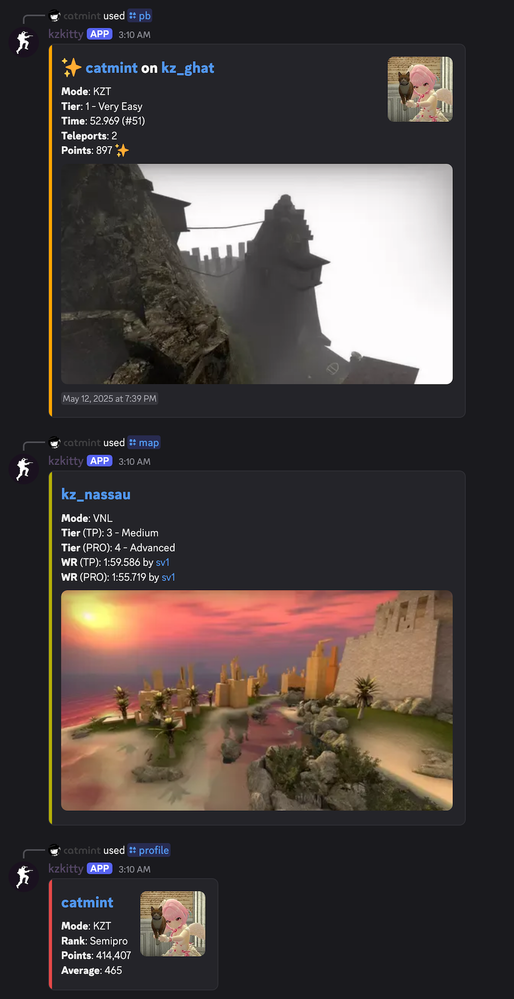

# kzkitty

Discord bot for the CS:GO and CS2 KZ global APIs.

Available commands:

- `/pb` - show a personal best run for a given map/mode/player
- `/latest` - show the most recent run
- `/profile` - show current rank, points, point average
- `/map` - show map info and world record times
- `/register` - register a steam profile url and default mode with the bot
- `/unregister` - unregister your steam profile
- `/mode` - change the default mode to use for commands
- `/server` - show server status (the map, who's playing, etc.)



## Development

To set up a dev environment (with `uv`):

```sh
git clone https://github.com/misscatmint/kzkitty.git ~/src/kzkitty
cd ~/src/kzkitty
curl -LsSf https://astral.sh/uv/install.sh | sh
uv sync
```

Then, to run locally:

```sh
KZKITTY_DB=sqlite://kzkitty.db KZKITTY_DISCORD_TOKEN=... uv run -m kzkitty
```

Optionally set the `KZKITTY_DEFAULT_PLAYERS` environment variable to point to
a CSV file in the following format:

```csv
user_id,server_id,steamid64,mode
...
```

This will prepopulate the database with Discord users mapped to Steam IDs and
preferred KZ game modes (on a per-Discord server basis).

Similarly, set `KZKITTY_DEFAULT_SERVERS` to a CSV file in the following
format:

```csv
name,address,game,preferred_mode,location,server_id,channel_id,message_id,is_default
...
```

Setting `channel_id` will make the bot keep one auto-updating status message
in that channel, covering every server with that `channel_id`. Set
`message_id` on any of those rows to reuse an existing message instead of
posting a new one. Rows for the same channel can't have different
`message_id`s. To show a server in more than one channel, give it one row per
channel. The first row's details (name, location, etc.) are used for all of
them. `is_default` controls what server `/server` uses by default.

`KZKITTY_REFRESH_DB_HOURS` can optionally be used to control how frequently
the map cache is updated from the global APIs. The default is 24 hours.

`KZKITTY_REFRESH_SERVER_MINS` controls how often the bot queries default
servers to update their Discord messages.

To control timeouts, set `KZKITTY_API_TIMEOUT`, `KZKITTY_STEAM_TIMEOUT`, and
`KZKITTY_A2S_TIMEOUT` (in seconds). They default to 3, 5, and 5 seconds
respectively.

Set `KZKITTY_REST` to an `address:port` to run the bot as a REST bot, or to
`1` to listen on `0.0.0.0:8080`. This requires an internet-facing HTTPS server
to proxy to kzkitty (see [Deploying as a REST bot](#deploying-as-a-rest-bot)).

`KZKITTY_URL` can be set to kzkitty's public URL to turn server IPs into links
that launch the game and join the server. This works for CS2 servers and the
standalone CS:GO app. Servers on the `csgo_legacy` beta branch of CS2 are
shown with a note instead, since a link can't choose that branch.

The sidecar is a second process that shows the bot as online (REST bots can't
do this themselves) and serves the join links. Run it with:

```sh
KZKITTY_DB=sqlite://kzkitty.db KZKITTY_DISCORD_TOKEN=... \
    uv run -m kzkitty sidecar
```

It listens on `KZKITTY_SIDECAR` (an `address:port`, defaulting to
`0.0.0.0:8081`).

## Deployment

To deploy with Docker Compose, use a `compose.yaml` file:

```yaml
name: kzkitty

x-hardening: &hardening
  restart: unless-stopped
  user: "1000:1000"
  cap_drop: [ALL]
  security_opt: [no-new-privileges:true]

services:
  kzkitty:
    <<: *hardening
    container_name: kzkitty
    build: https://github.com/misscatmint/kzkitty.git
    image: kzkitty
    environment:
      KZKITTY_DB: sqlite:///data/kzkitty.db
      KZKITTY_DEFAULT_PLAYERS: /data/players.csv
      KZKITTY_DEFAULT_SERVERS: /data/servers.csv
      KZKITTY_DISCORD_TOKEN: ${KZKITTY_DISCORD_TOKEN}
    volumes:
      - /etc/localtime:/etc/localtime:ro
      - ./data:/data
```

Put the Discord token in a `.env` file next to `compose.yaml`
(`KZKITTY_DISCORD_TOKEN=...`), and the CSV files in `./data`, which must be
writable by uid 1000. The bot uses the host's timezone (from
`/etc/localtime`) for nightly map database refreshes. Then build and start the
service:

```sh
docker compose up --build -d kzkitty
```

### Deploying as a REST bot

Replace `kzkitty.example.com` with a domain pointing at your server, and keep
the `x-hardening` block from above:

```yaml
services:
  kzkitty:
    <<: *hardening
    container_name: kzkitty
    build: https://github.com/misscatmint/kzkitty.git
    image: kzkitty
    environment:
      KZKITTY_DB: sqlite:///data/kzkitty.db
      KZKITTY_DEFAULT_PLAYERS: /data/players.csv
      KZKITTY_DEFAULT_SERVERS: /data/servers.csv
      KZKITTY_DISCORD_TOKEN: ${KZKITTY_DISCORD_TOKEN}
      KZKITTY_REST: 1
      KZKITTY_URL: https://kzkitty.example.com
    healthcheck:
      test: ["CMD", "python", "-m", "kzkitty", "healthcheck"]
      interval: 30s
      timeout: 10s
    volumes:
      - /etc/localtime:/etc/localtime:ro
      - ./data:/data

  kzkitty-sidecar:
    <<: *hardening
    container_name: kzkitty-sidecar
    build: https://github.com/misscatmint/kzkitty.git
    image: kzkitty
    command: ["python", "-m", "kzkitty", "sidecar"]
    environment:
      KZKITTY_DB: sqlite:///data/kzkitty.db
      KZKITTY_DISCORD_TOKEN: ${KZKITTY_DISCORD_TOKEN}
    volumes:
      - /etc/localtime:/etc/localtime:ro
      - ./data:/data

  caddy:
    <<: *hardening
    container_name: caddy
    image: caddy:2
    command: ["caddy", "run", "--config", "/data/Caddyfile",
              "--adapter", "caddyfile"]
    environment:
      XDG_CONFIG_HOME: /data/config
    ports:
      - "80:80"
      - "443:443"
      - "443:443/udp"
    volumes:
      - ./caddy:/data
```

`./caddy` must also be writable by uid 1000. Docker doesn't restart
containers that fail the health check, so it only affects their status.

Create `./caddy/Caddyfile`:

```
kzkitty.example.com {
	handle /connect/* {
		reverse_proxy kzkitty-sidecar:8081
	}
	handle {
		reverse_proxy kzkitty:8080
	}
}
```

Build and start everything:

```sh
docker compose up --build -d
```

Finally, in the Discord developer portal, set the application's
"Interactions Endpoint URL" to `https://kzkitty.example.com/`. Discord checks
the URL when you save it, so the bot must already be running.

If Caddy logs a permission error binding ports 80 or 443, add
`sysctls: [net.ipv4.ip_unprivileged_port_start=0]` to the `caddy` service.

### Rootless Docker

Under rootless Docker, change `user` in `x-hardening` to `"0:0"`. Container
root maps to your own (unprivileged) user, which owns `./data` and `./caddy`,
while uid 1000 would map to a subordinate ID that can't write them. Rootless
Docker also can't publish host ports below 1024 by default, so allow them for
Caddy on the host:

```sh
echo 'net.ipv4.ip_unprivileged_port_start=80' \
    | sudo tee /etc/sysctl.d/99-rootless-ports.conf
sudo sysctl --system
```

### Discord application

Note that you will need to visit https://discord.com/developers/applications
to create an application for the bot. This will give you the Discord token
needed above. The bot only requires `application.commands` and `bot` OAuth2
scopes. For bot permissions, only `send messages` and `send messages in
threads` are needed.
